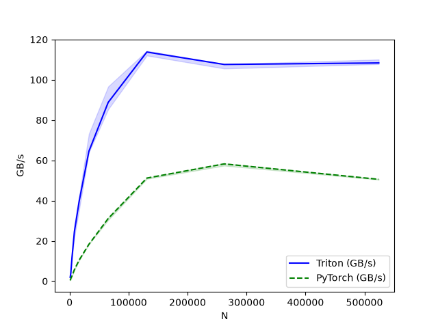

# RL Kernels: Triton kernels for reinforcement learning

[](https://www.python.org/downloads/)
[](#testing)
[](LICENSE)

[OpenAI Triton](https://github.com/triton-lang/triton) kernels for reinforcement learning and preference optimization algorithms.

---

## Overview

Modern deep learning workloads are frequently bottlenecked by **memory bandwidth** rather than compute capacity. Element-wise arithmetic, activations, and loss functions spend more time transferring tensors across GPU High Bandwidth Memory (HBM) than executing instructions on cores.

In standard PyTorch eager execution, compound operations trigger multiple sequential kernel launches that repeatedly materialize intermediate tensors across HBM, inflating peak VRAM and accumulating driver latency.

[OpenAI Triton](https://github.com/triton-lang/triton) kernels solve this by fusing multi-stage operations into single kernel launches executed directly on-chip in registers and SRAM—slashing memory traffic, eliminating autograd tape bloat via dedicated analytical backward passes, and delivering CUDA efficiency entirely in Python.

---

## Kernels

### Direct Preference Optimization (DPO)

The [Direct Preference Optimization (DPO)](https://arxiv.org/abs/2305.18290) loss kernel function (`compute_dpo_loss`) fuses policy/reference log-ratio differences, implicit reward margins, and numerically stable log-sigmoid losses into a single GPU kernel launch. It uses a backward Triton kernel as well. If Triton or CUDA is not available, the function falls back to a PyTorch implementation.

---

## Benchmarks

### DPO loss throughput

Memory bandwidth throughput benchmark comparing the fused Triton kernel against PyTorch eager execution across sequence/batch dimensions ($N$) on an **NVIDIA Tesla T4** (Google Colab). The fused Triton kernel achieves up to **5.32x speedup** on smaller sizes and sustains **~108–114 GB/s** peak memory bandwidth (vs. ~50–58 GB/s for PyTorch).



| N | Triton (GB/s) | PyTorch (GB/s) | Speedup |
| ---: | ---: | ---: | ---: |
| 1,024 | 1.92 | 0.36 | 5.32x |
| 2,048 | 3.97 | 1.31 | 3.03x |
| 4,096 | 11.70 | 2.62 | 4.47x |
| 8,192 | 24.60 | 5.72 | 4.30x |
| 16,384 | 39.86 | 10.53 | 3.79x |
| 32,768 | 64.50 | 18.29 | 3.53x |
| 65,536 | 88.80 | 31.12 | 2.85x |
| 131,072 | 113.78 | 51.20 | 2.22x |
| 262,144 | 107.61 | 58.23 | 1.85x |
| 524,288 | 108.37 | 50.57 | 2.14x |

Raw benchmark data is available in [dpo-loss-performance-colab-t4-20261005.csv](assets/benchmarks/dpo-loss-performance-colab-t4-20261005.csv).

---

## Getting started

Prerequisites: Python 3.14+ and [uv](https://github.com/astral-sh/uv).

Install dependencies:

```bash
uv sync --group dev --group benchmark
```

### Quickstart

Using the DPO loss kernel:

```python
import torch
from rl_kernels import dpo

policy_chosen = torch.tensor([-1.2, -0.8, -2.1, -1.5], requires_grad=True)
policy_rejected = torch.tensor([-2.5, -1.9, -2.0, -3.1], requires_grad=True)
ref_chosen = torch.tensor([-1.1, -0.9, -2.0, -1.6])
ref_rejected = torch.tensor([-2.4, -1.8, -2.2, -3.0])

# Uses Triton kernel if Triton and CUDA is available; otherwise switches to
# PyTorch implementation
loss, chosen_rewards, rejected_rewards, logits = dpo.compute_dpo_loss(
    policy_chosen_logps=policy_chosen,
    policy_rejected_logps=policy_rejected,
    ref_chosen_logps=ref_chosen,
    ref_rejected_logps=ref_rejected,
    beta=0.1,
)

loss.backward()

print(f"DPO Loss: {loss.item():.4f}")
print(f"Chosen rewards: {chosen_rewards}")
print(f"Policy chosen Gradients: {policy_chosen.grad}")
```

### Running benchmarks

Execute the DPO benchmark script on a machine with an accelerator:

```bash
uv run python -m benchmarks.benchmark_dpo
```

By default, this executes the benchmark suite and writes local output plots and CSV metrics to `benchmarks/results/`. Published reference results are documented in [Benchmarks](#benchmarks).

---

## Directory structure

```text
.
├── assets/                     # Published documentation assets and figures
├── src/rl_kernels/             # Fused Triton kernels, CPU fallbacks, and autograd functions
├── benchmarks/                 # Throughput, memory, and scaling benchmarks
│   └── results/                # Local runtime benchmark outputs
├── tests/
│   └── unit/                   # Fast zero-hardware mock and unit tests (<4s on CPU/MPS)
├── pyproject.toml              # uv-based Python project configuration
└── uv.lock                     # Hermetic dependency lockfile
```

---

## Testing

Run the complete test suite with coverage reporting:

```bash
uv run pytest
```

---

## Contributing

Contributions, feedback, and bug reports are welcome. To contribute:

1. Fork the repository and create a feature branch (e.g. `git checkout -b feat/my-feature`).
2. Verify all tests pass and linting succeeds (`uv run pytest && uv run ruff check .`).
3. Submit a pull request describing the rationale, changes made, and invariants preserved.

---

## License

This project is licensed under the Apache License 2.0 - see the [LICENSE](LICENSE) file for details.
